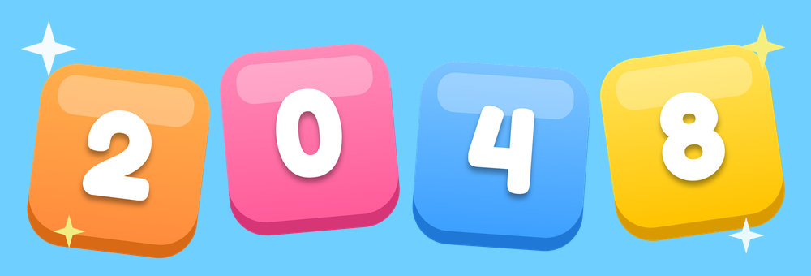
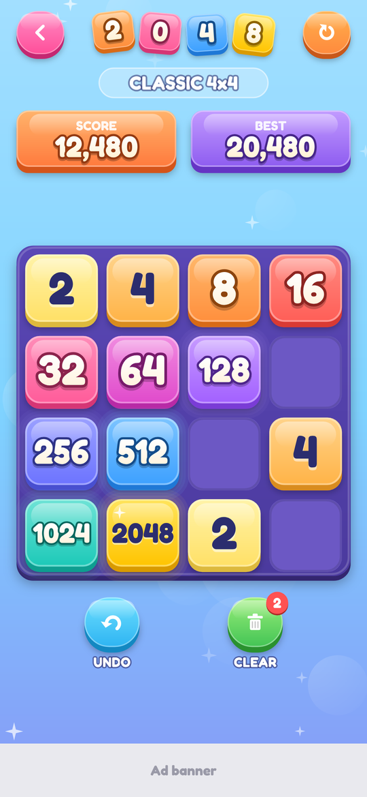
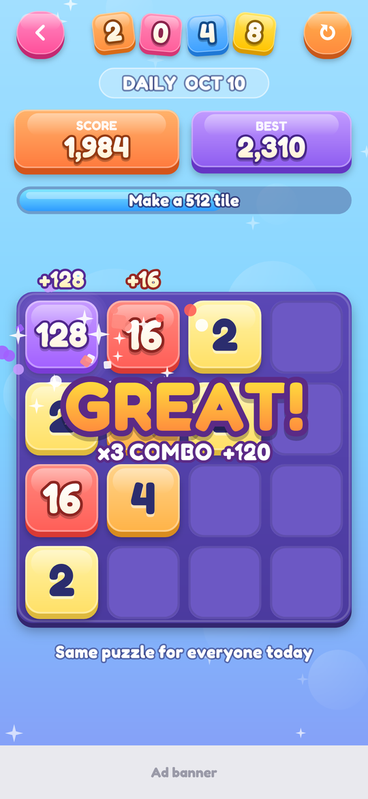
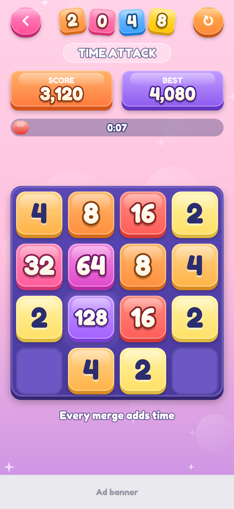
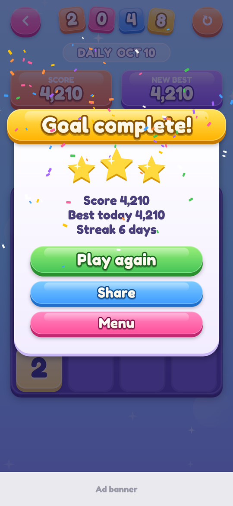

# 2048 Puzzle

A colourful 2048 game for Android with a permanent ad banner that players remove with a one-time purchase.
Written in C# with .NET MAUI, so it opens, builds and runs from Visual Studio.

   

_These images are drawn by the game's own scene renderer (`tools/Puzzle2048.Preview`). The grey strip is where the ad banner sits._

## What is in the game

- **Classic** on 4x4, 5x5 and 6x6 boards with undo, a tile-removal power-up and a saved game
- **Daily Challenge**: one puzzle per UTC day, the same tile sequence and goal for everyone, unlimited retries, best score of the day, a daily streak and a shareable result
- **Time Attack**: 60 seconds, every merge adds time (up to 90)
- **Sprint**: reach 512 as fast as you can
- **Combos**: merge on consecutive moves for up to +200% bonus points
- **Levels**: every point you score fills a level bar; completing a daily goal adds bonus points
- **Daily stars**: one to three stars for each daily challenge, shown on the menu
- **Game feel**: candy style tiles, bouncy slides and pops, particle bursts, floating points, praise words for combos and big tiles, confetti, screen shake, a level-up celebration and an animated backdrop
- **Sound**: bubble pops that rise in pitch with the tile value, plus jingles for combos, wins and level-ups. Can be switched off in Settings
- **Daily reminder**: optional, one evening notification, only if the daily challenge has not been played yet
- **Account**: optional Google Play Games sign-in with a cloud save of the level, streaks, records and stars, six leaderboards and ten achievements. "Delete my data" in Settings wipes the progress from the phone and the cloud. The game works fully without signing in
- **Ads and purchase**: Google AdMob banner at the bottom of every screen, removed by a one-time Google Play purchase (`remove_ads`)
- **Smooth on fast screens**: frames follow the display (60, 90, 120 or 144 Hz) and the game asks for the screen's highest refresh rate while you play. Swipes are read from raw touches and act as soon as the direction is clear
- English only, portrait, Android 7.0 (API 24) and newer, 64-bit devices

## Licenses and credits

- Font: Fredoka Bold by the Fredoka Project Authors, SIL Open Font License 1.1 (`src/Puzzle2048.App/Resources/Raw/Fredoka-OFL.txt`, shown in the app under About). Keep that file with the app.
- Libraries: .NET MAUI, Google Mobile Ads (AdMob) and Plugin.InAppBilling, under their own licenses.
- This is proprietary, closed-source software. All rights reserved, see [LICENSE](LICENSE). Keep this repository private.
